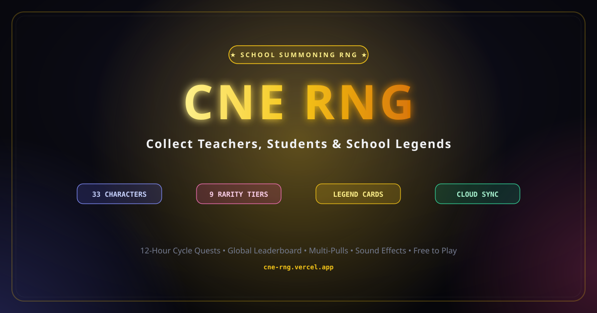

# 🎲 CNE RNG — School Edition Gacha & Summoning Game



A modern, high-production browser-based RNG summoning game featuring 33 custom school characters (Teachers, Students, and School Assistants), 9 rarity tiers including FIFA-style Legend cards, 12-hour quest cycles, persistent Cloud saves powered by Firebase, and a live global leaderboard.

---

## ✨ Features

- **🎰 High-Tension Summoning Reel**: Smooth continuous roulette animation with audio effects, pity counters, and high-rarity confetti celebrations.
- **⚡ Multi-Pull (10x - 26x)**: Staggered reveal slots with best pull showcase and batch coin rewards.
- **🌟 33 Characters across 9 Tiers**:
  - `COMMON` (1★)
  - `RARE` (2★)
  - `EPIC` (3★)
  - `LEGENDARY` (4-5★)
  - `MYTHIC` (6★)
  - `CELESTIAL` (7★)
  - `SECRET` (8★)
  - `LEGEND` (9★ — FIFA style gold-and-white card aesthetic: *Professora Vera*, *Rafael*, *Gonçalo Lopes*, *Pedro Lopes*, *Rita*, *Leonor Pacheco*, *Simão Costa*, *Dona Elisabete*)
  - `TRANSCENDENT` (10★)
- **🎒 Boosters & Consumables**: Master Roll (1000x luck), Celestial Orb (50x luck), Golden Clover (10x luck), Silver Horseshoe (3x luck).
- **📜 12-Hour Quest Cycles & Milestones**: 10 active cycle quests with countdown timer, quest reroll items, and prestige titles.
- **☁️ Firebase Cloud Sync**: Progress (coins, inventory, unlocks, quests) automatically syncs to Firebase Cloud Firestore.
- **🏆 Global Leaderboard**: Compete against friends with custom avatars and unlocked prestige titles.

---

## 🚀 Deploy to Vercel (3 Steps)

### Step 1: Push to your GitHub Repository
```bash
git init
git add .
git commit -m "Initial commit: CNE RNG"
git branch -M main
git remote add origin https://github.com/YOUR_USERNAME/cne-rng.git
git push -u origin main
```

### Step 2: Import into Vercel
1. Go to [vercel.com](https://vercel.com) and log in with your GitHub account.
2. Click **Add New...** > **Project**.
3. Select your `cne-rng` repository and click **Import**.
4. Leave all settings at default (it's a static HTML/JS site, `vercel.json` is already configured).
5. Click **Deploy**!

### Step 3: Firebase Configuration
Your app comes pre-configured with Firebase Cloud (`cne-rng`). Make sure you have:
1. Enabled **Email/Password** under **Authentication > Sign-in method** in the Firebase Console.
2. Published the included `firestore.rules` under **Firestore Database > Rules** in the Firebase Console.

---

## 🛠️ Local Development
Simply double-click `index.html` or serve via any static file server:
```bash
python -m http.server 8000
```
Open `http://localhost:8000` in your browser.

---

## 📄 License
MIT License. Built for CNE.
